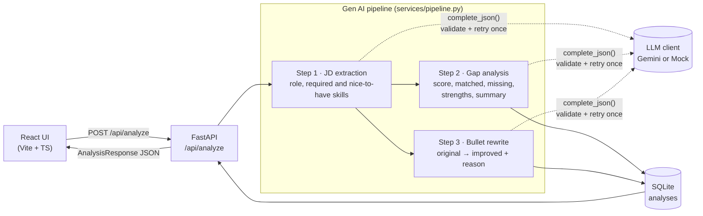

# HireLens – AI Resume & Job-Match Assistant

HireLens compares a resume with a job description using a 3-step LLM pipeline. It returns a **match score**, **matched and missing skills**, **strengths**, a short **summary**, and **resume bullets rewritten for the role**. Every analysis is saved, so you can reopen it from the history sidebar.


<!-- Placeholder: add a screenshot at docs/screenshot.png -->

**Stack:** React 19 + TypeScript + Vite · FastAPI · Pydantic v2 · SQLAlchemy 2 (SQLite) · Google Gemini (via httpx) · pytest · Vitest + React Testing Library

---

## Features

- Paste a resume or **upload a PDF** (text extracted server-side with `pypdf`)
- **3-step Gen AI pipeline** with a separate, schema-validated prompt for each step
- Circular match-score ring, green/red skill chips, strengths, summary
- Before/after bullet cards with one-click copy
- History sidebar backed by SQLite
- Runs **fully offline** with a keyword-based `MockClient`, so no API key is needed to try it or run the tests
- Accessible UI: labelled fields, ARIA live regions, a `meter` role for the score, visible keyboard focus, a skip link, dark mode and reduced-motion support

## Architecture



**Why this design:**

| Decision | Reason |
| --- | --- |
| Three small prompts instead of one big one | Each step has one job and its own schema, so output is more reliable and easier to debug. Step 1's structured requirements feed both later steps. |
| Steps 2 and 3 run concurrently (`asyncio.gather`) | Both depend only on step 1, so total latency is about step 1 plus the slower of steps 2 and 3. |
| `complete_json(prompt, Model)` | Every LLM reply is validated with Pydantic. On failure the prompt is re-sent once **with the validation errors attached** so the model can fix its own output. After that it raises `LLMError`, which the API maps to **HTTP 502**. |
| Output schema generated from Pydantic (`model_json_schema()`) | The prompt and the validator can't drift apart. |
| User text wrapped in `<resume>` / `<job_description>` tags | Separates data from instructions and reduces prompt-injection risk. |
| `LLMClient` protocol + FastAPI dependency injection | Gemini and the mock are interchangeable. Tests override `get_llm_client` and `get_db` without patching. |
| Gemini via raw `httpx` (JSON mode) | Small dependency footprint and an explicit request/response shape. Timeouts and HTTP errors also become `LLMError`. |

### Project structure

```
hirelens/
├── .github/workflows/     # deploy-pages.yml: frontend → GitHub Pages
├── backend/
│   ├── app/
│   │   ├── main.py            # app factory, CORS, LLMError → 502, health
│   │   ├── config.py          # pydantic-settings (.env)
│   │   ├── database.py        # engine, session, get_db dependency
│   │   ├── models.py          # SQLAlchemy Analysis model
│   │   ├── schemas.py         # LLM step schemas + API schemas
│   │   ├── prompts.py         # all prompt templates
│   │   ├── deps.py            # get_llm_client dependency
│   │   ├── api/               # analysis.py (analyze, extract-text), history.py
│   │   ├── llm/               # base.py (LLMClient, LLMError, complete_json), gemini.py, mock.py
│   │   └── services/          # pipeline.py, repository.py, pdf.py
│   └── tests/                 # pytest: API, LLM retry/502, PDF extraction
├── frontend/
│   └── src/
│       ├── api.ts             # typed API client (VITE_API_URL)
│       ├── types.ts           # mirrors backend response models
│       ├── validation.ts      # form rules (mirrors backend limits)
│       ├── App.tsx
│       └── components/        # AnalyzeForm, PipelineProgress, Results, ScoreRing,
│                              # SkillChips, BulletCard, HistorySidebar (+ __tests__)
└── render.yaml                # Render blueprint for the API
```

## API

| Method | Path | Description |
| --- | --- | --- |
| `GET` | `/api/health` | Liveness check and active LLM provider |
| `POST` | `/api/analyze` | `{ resume_text, jd_text }` (each 50–20,000 chars). Runs the pipeline, saves the result and returns it (`201`). `422` on invalid input, `502` if the LLM fails. |
| `POST` | `/api/extract-text` | Multipart PDF upload (≤ 5 MB) → `{ filename, pages, text }` |
| `GET` | `/api/history` | Recent analyses: `id`, `role_title`, `match_score`, `created_at` |
| `GET` | `/api/history/{id}` | Full saved analysis (`404` if not found) |

Interactive docs: http://localhost:8000/docs

## Run locally

Prerequisites: **Python 3.11+** and **Node.js 20+**.

### Backend

```bash
cd backend
python -m venv .venv
# Windows: .venv\Scripts\activate    macOS/Linux: source .venv/bin/activate
pip install -r requirements-dev.txt
cp .env.example .env        # Windows: copy .env.example .env
uvicorn app.main:app --reload
```

The API runs on http://localhost:8000. It uses `LLM_PROVIDER=mock` by default. To use Gemini, set `LLM_PROVIDER=gemini` and `GEMINI_API_KEY=...` in `backend/.env` (get a key at https://aistudio.google.com/apikey).

| Variable | Default | Purpose |
| --- | --- | --- |
| `LLM_PROVIDER` | `mock` | `gemini` or `mock` |
| `GEMINI_API_KEY` | – | Required when the provider is `gemini` (the app refuses to start without it) |
| `GEMINI_MODEL` | `gemini-3.8-flash` | Gemini model id |
| `DATABASE_URL` | `sqlite:///./hirelens.db` | SQLAlchemy URL |
| `CORS_ORIGINS` | `http://localhost:5173` | Comma-separated allowed origins |

### Frontend

```bash
cd frontend
npm install
cp .env.example .env        # VITE_API_URL=http://localhost:8000
npm run dev
```

Open http://localhost:5173.

## Tests

```bash
# Backend: uses MockClient + a temporary SQLite DB per test, no API key needed
cd backend
pytest

# Frontend: Vitest + React Testing Library (jsdom)
cd frontend
npm test
```

Backend coverage: health, a successful analysis, input validation (422), history list and detail and 404, `complete_json` code-fence stripping and dedup, retry-then-success, retry-then-502 (nothing saved on failure), and PDF extraction (valid, non-PDF 415, corrupt 422).

Frontend coverage: `ScoreRing` (accessible meter, clamping, arc maths, colour bands) and `AnalyzeForm` (required and min-length errors, focus management, trimmed submit, loading state, PDF import).

## Deploy

| Part | Host | URL |
| --- | --- | --- |
| Frontend (`frontend/`) | GitHub Pages | https://bhavadharanithangaraj.github.io/hirelens/ |
| API (`backend/`) | Render free tier | https://hirelens-api-eslq.onrender.com |

### Frontend → GitHub Pages

[`.github/workflows/deploy-pages.yml`](.github/workflows/deploy-pages.yml) runs the tests, builds with `npm run build:pages` (which sets Vite's `base` to `/hirelens/`) and publishes `frontend/dist` on every push to `main` that touches `frontend/`. One-time setup: **Settings → Pages → Source: GitHub Actions**.

The API URL is set by `VITE_API_URL` in the workflow. Vite inlines it at build time, so re-run the workflow after changing it.

### Backend → Render

1. In Render, choose **New → Blueprint**, connect the repo and click **Apply**. Render reads [`render.yaml`](render.yaml) and creates the `hirelens-api` web service.
2. When prompted, set `GEMINI_API_KEY` (free key at https://aistudio.google.com/apikey). To demo without a key, set `LLM_PROVIDER=mock` instead.

`CORS_ORIGINS` is preset to the Pages origin. Render added a suffix to the service URL because `hirelens-api` was taken; if you redeploy under a different URL, update `VITE_API_URL` in the workflow.

> **Notes:** Free instances sleep after about 15 minutes idle, so the first request can take up to a minute. Their filesystem is ephemeral, so the SQLite history resets on each deploy or restart. For persistent history, attach a Render PostgreSQL database, set `DATABASE_URL` to its URL (`postgresql+psycopg://...`) and add `psycopg[binary]` to `requirements.txt`. No code changes are needed because the app goes through SQLAlchemy.

## Possible next steps

- Stream real pipeline progress to the UI with Server-Sent Events (the current progress indicator is time-based)
- Alembic migrations and PostgreSQL in production
- User accounts so each person sees only their own history
- An evaluation set of resume/JD pairs to regression-test prompt changes
